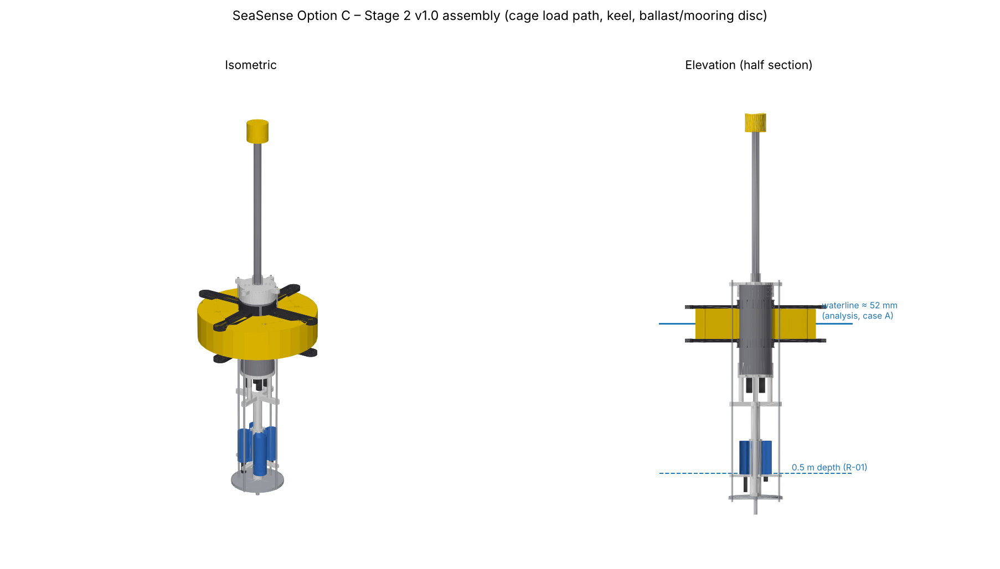
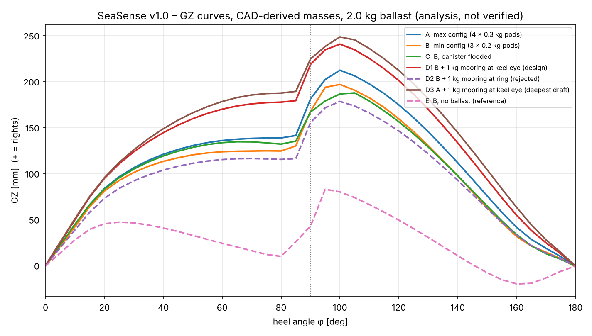

# SeaSense

**A low-cost, 3D-printed, modular buoy that continuously monitors water conditions in a maritime test area in the Blekinge archipelago.**

BUILD X hackathon · Saab / MTC "Prompt-to-Product" challenge.

> **Status:** concept, analysis and CAD. **Nothing has been built or tested yet.** Every number below is an analysis estimate from the frozen project files ([docs/](docs)) unless it says otherwise.

---

## 1. Need

The scenario is **hypothetical**. We used **no internal Saab or MTC knowledge**; anything about Saab, MTC or The Fishery is stated as an assumption in the frozen files.

A marine test centre (MTC) runs trials in a test area in the Blekinge archipelago, an area that suffers from eutrophication, algal blooms and low-oxygen zones. It needs continuous water data. Three user groups ([brief](prompts/00-setup/brief.md)):

| User group | Need |
|---|---|
| **Test engineers** (e.g. from Saab: uncrewed vessels, underwater vehicles, sonar) | Water conditions during each trial, in near real time, time- and position-stamped, comparable between runs |
| **MTC environmental staff** | A long, credible record showing that trials do not harm the environment |
| **Maintenance staff** | Deploy and service buoys from a small boat, with long service intervals and local repair at The Fishery |

## 2. Approach



*Stage 2 v1.0 assembly: ring float, canister, rod cage, keel, pods and ballast/mooring disc. Headless render from [cad/render_assembly.py](cad/render_assembly.py).*

| Item | Key facts (estimates) | Source |
|---|---|---|
| **Float** | Foam-filled ring, OD 400 / ID 130 × 100 mm, printed as 4 × 90° ASA trays with bonded lids (each part ≤240 mm). A crack only floods foam | [Stage 2 §2, §9](docs/stage2-concept-cad-v1.0.md) · R-25, R-27 |
| **Canister** | 110 mm PVC-U pipe × 300 mm; ASA top cap with double O-ring (opens for service); bottom cap bonded with Plexus MA300; 4 × M12 A-coded IP68 ports | [Stage 2 §7](docs/stage2-concept-cad-v1.0.md) · R-15, R-24 |
| **Rod cage** | 4 × M6 A4 stainless rods tie top cap, ring and keel to the disc. The pipe is positively retained, and no printed part carries the mooring in bending | [Stage 2 §2](docs/stage2-concept-cad-v1.0.md) · R-26 |
| **Keel + disc** | Printed keel column; laser-cut A4 disc Ø180 × 10 mm = 2.0 kg ballast **and** mooring point (M12 eye bolt, ≥2 kN). Rights itself from 5° to 175° (min GZ 7.2 mm); reserve buoyancy 60 % intact, 35 % with the canister flooded (still floats) | [Stage 2 §3, §5](docs/stage2-concept-cad-v1.0.md) · R-25, R-26 |
| **Pods** | 4 per-sensor pods with a common interface: temperature (Blue Robotics Celsius), salinity (Atlas EC K1.0), oxygen (Atlas galvanic DO), optional turbidity (DFRobot SEN0189); temperature tip ≈0.53–0.54 m deep | [Stage 2 §6](docs/stage2-concept-cad-v1.0.md) · R-01…R-04, R-19 |
| **Electronics** | RAK4630 (nRF52840 + LoRa 868 MHz + BLE), u-blox MAX-M10S GNSS, LSM6DSOX IMU (DO motion flag, capsize log, waves), BME280 + leak comb, 16 MB flash, 2 × 6 Ah LiFePO4. Per-port current-limited 12 V and RS-485 / Modbus RTU | [Stage 3 §1–2](docs/stage3-electronics-v1.0.md) |
| **Data** | **34-byte** LoRaWAN sample message with **22 quality flags** (u24, 2 bits reserved); flagged values are always sent; ≤0.38 % airtime at SF12 (38 % of the 1 % limit); private network server on our own gateway | [Stage 3 §4](docs/stage3-electronics-v1.0.md) · R-09, R-12, R-37 |
| **Endurance** | **≈42 days** core set at 10-min sampling (R-20a ≥30 d); **≈112 days** with the 90-day profile at 20 min (R-20b ≥90 d). Unmeasured | [Stage 3 §3](docs/stage3-electronics-v1.0.md) |
| **Size / mass** | Ring Ø400 mm; ≈1.3 m from eye bolt to light top (derived from the CAD layout); **≈8.85 kg** full load vs ≤9 kg (margin 0.15 kg, below the estimate's uncertainty, so weighing test T1 decides) | [Stage 2 §2, §4](docs/stage2-concept-cad-v1.0.md) · R-31 |
| **Cost vs target (CR-05)** | Base ≈5,400 SEK vs ≤5,000 (**likely exceeded**); core sensors ≈6,940 vs ≤7,500 ✓; complete buoy **≈12,340 vs ≤12,500 SEK** ✓ (≈160 SEK margin). Shore gateway not included (one-off ≈4,000–6,000 SEK) | [Stage 3 §6](docs/stage3-electronics-v1.0.md) · R-30a, R-30b |



*Righting-arm (GZ) curves for load cases A–E. Positive = the buoy turns back upright. Without ballast (case E) it is stable upside down. Generated by [stability/report.py](stability/report.py).*

## 3. Benefit & competition

- **About 1/7 of the reference price.** Reference: YSI EXO1 + CT + optical DO ≈ $8,650 (≈86,000 SEK, ysi.com list prices, team figure). Our complete buoy is estimated at ≈12,340 SEK. Note: their figure is the sonde only; ours includes buoy, power and telemetry but excludes the shore gateway.
- **Coverage over precision.** For the price of one high-end sonde, a test area can have several buoys, which suits 10–20 buoys in a first season.
- **Modular.** 4 identical ports, daisy-chain capable RS-485; a new sensor needs only a firmware driver and a printed pod (R-15, R-19). The future bottom-oxygen module (R-35) is already planned for.
- **Locally printable.** Every printed part fits a 240 mm build volume (R-27), so it can be made and repaired in a local workshop.
- **Useful for test engineers.** Time- and position-stamped data in near real time, a 1-minute trial mode, and indicative wave statistics (Hs, Tp) from the IMU (R-37).
- **Honest trade-offs.** The YSI setup is **far more accurate and robust**. Our galvanic DO probe needs water movement (flagged in calm water), turbidity is indicative only, M12 connectors are not rated for underwater use (immersion test planned), and none of our numbers is tested yet.

## 4. Process

**Tools:** Claude (one Claude project with fixed [instructions](prompts/00-setup/project-instructions.md); one chat per stage; a separate reviewer chat), CadQuery (parametric CAD in Python), Python with NumPy and Matplotlib (hydrostatics, GZ curves, power and airtime), web search for datasheets and prices.

**Loop:** prompt → AI output → **review** (hand calculations, re-running the AI's code, reading the CAD code) → team decisions → follow-up prompt → … → freeze. Stage chats generate; the reviewer chat checks and drafts follow-up prompts; **the team sets the constraints, makes every decision and approves every freeze.** Changes to frozen baselines go through named change requests (CR-01…CR-05) and proposals (P-1…P-4).

| Stage | Rounds | Key moments | Frozen output |
|---|---|---|---|
| 0 Setup | — | Four candidate problems → eutrophication monitoring; Sense → Predict → Trace → Act cut to the buoy; hypothetical brief in client-brief style | [brief](prompts/00-setup/brief.md) |
| 1 Requirements | 3 | We found the hull vs printer volume conflict and cut ~28 Musts to ~15; the AI found the missing mooring weight and proposed Option C; we corrected GNSS fix time 5 → 30 s and set 240 mm parts from real printers | [requirements-v1.0](docs/requirements-v1.0.md) |
| 2 Concept & CAD | 3 | The AI found the buoy is stable upside down without a keel; re-running its script, we found the wrong mooring point and old masses (→ 2.0 kg ballast); reading its CAD, we found a friction-held pipe and overstressed spokes → rod cage + stainless disc; the AI flagged connectors not rated for underwater use; test plan T0–T6 | [stage2-concept-cad-v1.0](docs/stage2-concept-cad-v1.0.md), [requirements-v1.1](docs/requirements-v1.1.md) |
| 3 Electronics | 2 | The AI found power ≈3× Stage 1, its own stirrer conflicting with R-33, the TTN limit, trial mode only at SF ≤10, and no antenna path; we verified energy, endurance, airtime and pinout by hand; CR-05 cost targets; R-37 waves | [stage3-electronics-v1.0](docs/stage3-electronics-v1.0.md), [requirements-v1.2](docs/requirements-v1.2.md) |

➡ **Full prompt log with every prompt, AI answer and review: [prompts/](prompts/README.md)**

## 5. Next steps & needs

| # | Next step | Verifies |
|---|---|---|
| 1 | **1:2 scale-model inversion test** (T0): print the ring in one piece, trim to 1.03 kg; in parallel, adhesive lap-shear coupons (T2a) | Self-righting model (R-25); bond (R-24) |
| 2 | **Bench electronics prototype**: RAK4631 WisBlock, MAX-M10S, LSM6DSOX and one isolated EC pod on 30 m cable; log current over a full cycle | Replaces estimated pod and GNSS currents (R-20a/b) |
| 3 | **Full prototype + seal tests**: weigh and find the CG (T1); vacuum and 72 h immersion tests (T2b, T2c) | R-31, R-24 |
| 4 | **Mooring proof load** at 2 kN (T3a/b) and a **harbour test at The Fishery** (T4, T4f, T5: float, tilt, flooded canister, 7 days moored) | R-26, R-25, R-33 |
| 5 | **Bottom-oxygen module** on the mooring line (R-35) | Low-oxygen zones near the seabed |
| 6 | **Shore-side ML forecasting**: the "Predict" layer of our original Sense → Predict → Trace → Act vision | Future vision |

**What we would need**
- **Access to The Fishery** (printing, workshop, harbour) for the tests above.
- **Parts budget** for prototypes (estimate: complete buoy ≈12,340 SEK, shore gateway ≈4,000–6,000 SEK one-off).
- **A shore gateway site** with power, internet and line of sight to the test area (R-36).
- **MTC input:** confirm the cost targets (CR-05), BLE service windows, a 20-min interval for 90-day deployments, gateway coverage (assumptions 13–15 in [requirements-v1.2](docs/requirements-v1.2.md)), and whether buoy placement needs permission from Swedish authorities.

## 6. Repository structure

```
README.md                     this file
prompts/                      prompt log: prompt, AI response, review for every round
  README.md                   the loop, roles, stages, highlights
  00-setup/                   problem selection, project instructions, brief
  01-requirements/            r1–r3
  02-concept-cad/             r1–r3
  03-electronics/             r1–r2
docs/                         frozen baselines only
  requirements-v1.0.md        Stage 1
  requirements-v1.1.md        + CR-01…CR-04
  requirements-v1.2.md        + CR-05, R-37, P-3 (current)
  stage2-concept-cad-v1.0.md
  stage3-electronics-v1.0.md
cad/
  seasense_parts.py           parametric CadQuery parts + assembly (parameters tagged with R-IDs)
  render_assembly.py          headless assembly render
  render_parts.py             parts sheet
  stl/                        13 printed parts
  out/                        STEP, GLB, renders, ballast_disc.dxf
stability/
  stability.py                point-cloud hydrostatics and GZ model
  report.py                   load cases A–E -> gz_curves.png, results.json
  gz_curves.png
  results.json
firmware/
  main_skeleton.c             main-cycle skeleton from stage3-electronics-v1.0 §5 (concept, not compiled)
```

### Regenerate the CAD and the GZ curves

```bash
pip install cadquery numpy matplotlib     # tested by the AI with CadQuery 2.8, Python 3.13

cd cad
python seasense_parts.py                  # rebuilds stl/, out/*.step, out/*.glb, out/ballast_disc.dxf; prints R-27 bbox check
python render_assembly.py 52              # out/seasense_assembly.png (argument: waterline z in mm)
python render_parts.py                    # out/seasense_parts_sheet.png

cd ../stability
python report.py                          # gz_curves.png, results.json and the stability tables (needs only numpy + matplotlib)
```

To change the design, edit the parameters at the top of `cad/seasense_parts.py` (each is tagged with its requirement ID). If you change a mass or a height, also update `MASS_V10` and the geometry constants in `stability/stability.py`, then re-run `report.py`. Other viewers: open `out/seasense_assembly.step` in FreeCAD, or `out/seasense_assembly.glb` in Blender.

## 7. Team

| Name | Role | Contribution | Contact |
|---|---|---|---|
| `<name>` | `<role>` | `<what you did>` | `<email / LinkedIn>` |
| `<name>` | `<role>` | `<what you did>` | `<email / LinkedIn>` |
| `<name>` | `<role>` | `<what you did>` | `<email / LinkedIn>` |
| `<name>` | `<role>` | `<what you did>` | `<email / LinkedIn>` |
