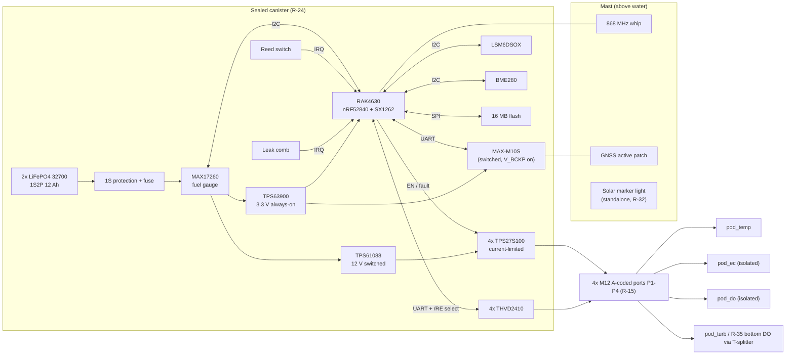

# SeaSense — Stage 3 Electronics, v1.0 (FROZEN 2026-11-14)

Status: **Frozen** by team decision on 2026-11-14. This is the baseline for Stage 4 onward; changing it requires a change request. Replaces the draft `stage3-electronics.md` (v0.1).
Baselines: **requirements-v1.2** (includes CR-05, R-37, P-3) and **stage2-concept-cad-v1.0** (frozen; P-1, P-2 and P-4 below are approved changes to it).

**Team decisions at freeze:** P-1 to P-4 approved (§7); R-37 pass criterion Hs ±20 % or ±5 cm and Tp ±0.5 s against a reference; assumptions A8–A10 added (to be confirmed with MTC).
Team inputs for this stage:
- **CR-05** (team, "to be confirmed with MTC"): R-30a base buoy ≤ **5,000 SEK**, R-30b core sensor set ≤ **7,500 SEK**, complete buoy ≤ **12,500 SEK**. Rationale: a YSI EXO1 + CT + optical DO costs ≈86,000 SEK (team figure, not verified here).
- **R-37 (new, Should):** report indicative wave statistics (Hs, Tp) from the IMU, flagged "indicative". Verification: T against a reference (Stage 5); pass criterion Hs ±20 % or ±5 cm, Tp ±0.5 s.
- CR-05, R-37 and P-3 are incorporated in **requirements-v1.2**.

All numbers below are **concept estimates, not verified**. Prices: web retail, ≈11 SEK/EUR and ≈10 SEK/USD, quantity 20, ex VAT, not quotes.

---

## 1. Electronics selection

### 1.1 Main board (inside the canister)
| # | Function | Part (example) | Why / key spec | ≈SEK | Req | 2nd source (R-28) |
|---|---|---|---|---|---|---|
| 1 | MCU + LoRa + BLE | **RAKwireless RAK4630-8** (nRF52840 + SX1262, EU868 variant) | 64 MHz Cortex-M4F, 256 kB RAM (enough for the wave FFT); LoRaWAN class A; BLE gives workshop firmware update and configuration **without opening the canister**; sleep ≈4 µA (datasheet) | 180 | R-07, R-12, R-14 | Several EU distributors (TBC). Fallback: discrete nRF52840 module + SX1262 module running the same firmware |
| 2 | GNSS | **u-blox MAX-M10S** + active patch antenna in the mast top | Low power; backup supply (V_BCKP) allows hot starts; time pulse for ±1 s | 150 + 120 | R-06, R-11 | Quectel LC76G (needs a driver change) |
| 3 | LoRa antenna | 868 MHz ½-wave whip, ≈2 dBi, on the mast | 14 dBm conducted + ≤2.15 dBi stays within 25 mW ERP | 220 | R-07, R-12 | Many |
| 4 | RF feedthroughs | 2 × IP68 SMA bulkheads (or potted coax glands) in the top cap | **Not in Stage 2 v1.0** (see §7, change proposal P-1) | 110 | R-24 | Many |
| 5 | IMU | **ST LSM6DSOX** (6-axis, 9 kB FIFO) | Accelerometer runs continuously at 12.5 Hz in low-power mode; gyro is off by default (it would cost ≈0.55 mA). Supports the DO motion flag, capsize log and waves | 35 | R-37, R-03/R-09 flags | Bosch BMI270 |
| 6 | Canister environment | **Bosch BME280** (T, RH, p) | Humidity rise = early leak warning; pressure trend = seal integrity | 45 | R-10, R-24 | SHT40 + LPS22HB |
| 7 | Leak probe | Gold-plated (ENIG) interdigitated comb PCB, 20 × 30 mm, on the cap floor next to the connector nuts; 1 MΩ pull-up to a wake-capable GPIO | Draws no current when dry; wakes the MCU immediately when wet | 20 | R-10 | — |
| 8 | Storage | **Winbond W25Q128JV** 16 MB NOR flash | 30 days at 1-minute sampling = 43,200 × 34 B ≈ 1.5 MB, so >10× margin | 20 | R-08 | Macronix MX25L128 |
| 9 | Battery | **2 × LiFePO4 IFR32700 6 Ah, 1S2P** (12 Ah) | ≈2 × 0.14 kg (TBC), fits the 0.30 kg Stage 2 allowance; sealed cells | 250 | R-20a/b, R-34 | Nkon (NL) and other EU cell shops |
| 10 | Battery protection | 1S LiFePO4 protection board (over/undervoltage, overcurrent) + 3 A fuse | | 60 | R-34 | — |
| 11 | Fuel gauge | **ADI MAX17260** + 10 mΩ shunt (coulomb counter) | LFP voltage is too flat to give state of charge from voltage. LiFePO4 model support: TBC | 45 | R-10 | Firmware coulomb estimate |
| 12 | 3.3 V rail (always on) | **TI TPS63900** buck-boost (Iq ≈75 nA) | Battery range 2.5–3.65 V | 30 | R-20 | TPS63802 |
| 13 | 12 V port rail (switched) | **TI TPS61088** boost (≤12.6 V), enabled only while ports are on | Keeps the voltage drop over 30 m cable small (§2.2) | 40 | R-15, R-17(F) | MPS MP3428 |
| 14 | Port power ×4 | **TI TPS27S100** high-side switch, current limit ≈0.3 A, fault output | One flooded or shorted port cannot take down the others | 70 | R-15 | Infineon PROFET family |
| 15 | RS-485 ×4 | **TI THVD2410** (3.3 V, ±70 V bus-fault protection) | Survives 12 V shorted onto a data pin in a flooded connector | 90 | R-15 | ADI LTC2862 (±60 V) |
| 16 | Protection ×4 | SM712 TVS (data lines), SMBJ15A (12 V) | ESD and surge on the external cables | 40 | R-15 | Many |
| 17 | Service | Reed switch, operated by an external magnet | Arm at deployment; opens a 10-minute BLE service window | 25 | R-14 | — |
| 18 | PCB | 4-layer, ≈90 × 140 mm, assembled | Fits the 110 mm pipe (inner diameter ≈103 mm) on a printed sled | 150 | — | JLCPCB, PCBWay, Eurocircuits (EU) |
| 19 | Harness, misc | JST connectors, leads to the 4 M12 sockets (sockets already costed in Stage 2), sled | | 150 | — | — |
| | **Base electronics total** | | | **≈1,850** (range 1,400–2,300) | R-30a | |

**Design choices**
- **Yellow flashing light (R-32):** a self-contained solar marker light, not powered by the buoy battery. This keeps the power budget clean; its cost is in the mechanical estimate (§6).
- **Bus topology:** four transceivers share one UART. DI and DE go to all four ports; /RE is decoded per port (74LVC1G139), so only one receive line (RO) is active at a time. Modbus addresses are unique across the whole buoy, so sending to all ports at once does no harm, and each port's driver is still isolated from faults on the others.
- **Remote and workshop access (R-14):**
  - Interval, trial mode and similar settings: LoRaWAN downlink (FPort 10).
  - Firmware: MCUboot + BLE (SMP) with signed images.
  - BLE is enabled only after a magnet swipe, so it costs no power and gives no attack surface during deployment.
- **Battery charging:** the top cap is opened in the workshop. It sits above the waterline and is designed to be removed. Charging through a port is possible later but not in the concept.

### 1.2 Sensor pod node (fits the Ø34 × ≈60 mm potted volume, R-15, R-19)
One common node design for all pods (R-19). Atlas isolated carrier boards (56 × 32 mm) do not fit, so isolation is built onto the node itself.

| Board (Ø30 mm disc) | Contents | Fitted on |
|---|---|---|
| A — bus side | SMBJ15A, 12→5 V buck (TI TPS560430, 4–36 V in), 5→3.3 V LDO, THVD2410 + SM712, MCU **STM32G031F6** (Modbus RTU slave), I²C/ADC header, spare MOSFET output (stirrer dropped, P-4) | All pods |
| B — isolated side | 2-channel digital isolator **TI ISO7721** (UART), **Murata NXE1S0505MC** 1 W isolated DC-DC (12.7 × 10.4 mm), EZO footprint (13.97 × 20.16 mm), SMA to the probe | pod_ec, pod_do |

| Pod | Sensor interface | Isolated? | Node ≈SEK |
|---|---|---|---|
| pod_temp | Blue Robotics Celsius, I²C 3.3 V | No (no galvanic measurement) | 100 |
| pod_ec | Atlas EZO-EC (UART) + ENV-40-EC-K1.0 | **Yes**: EC and DO probes share the water and would interfere | 190 |
| pod_do | Atlas EZO-DO (UART) + ENV-40-DOX (galvanic) | **Yes** | 190 |
| pod_turb | DFRobot SEN0189, analog 0–4.5 V on 5 V | No (optical, fully potted) | 100 |

- **Bus settings:** Modbus RTU, 19,200 baud, 8E1. Fixed 120 Ω termination and fail-safe bias on the main board; an M12 120 Ω terminator plug at the far end of each chain.
- **Addresses** are set by module type: 0x10 temp, 0x20 EC, 0x30 DO, 0x31 bottom DO (R-35), 0x40 turbidity.
- **Register map:** a common header (type, serial, firmware, calibration ID, calibration date) prepares for R-18 (Future).
- **Compensation:** the main MCU writes the temperature (and the salinity, for DO) to the EC and DO nodes before each reading.
  - Practical salinity is computed on the main board (PSS-78, from C and T), so the algorithm is documented in one place (R-02, R-09).
- **Fit (TBC):** the isolated board needs ≈63 % of a Ø30 disc. Make a 3D layout before the potting design is finalised.

---

## 2. Block diagram and port pinout

### 2.1 Block diagram


### 2.2 M12 A-coded 5-pole port pinout (identical on P1–P4, R-15)
Female sockets on the buoy (the powered side, so no live pins are exposed); male plugs on the pod cables. The pin layout follows the DeviceNet/CANopen M12 convention, so off-the-shelf cordsets, T-splitters and 120 Ω terminators can be used. Pins 4/5 are a twisted pair with ≈120 Ω impedance in those cables.

| Pin | Signal | DeviceNet colour | Notes |
|---|---|---|---|
| 1 | Shield / drain | bare | Bonded to canister GND through 1 MΩ ∥ 1 nF at the buoy only. Option: spare pin for a one-wire module ID (R-18, F) if unshielded cable is used |
| 2 | +12 V switched | red | Current limit ≈0.3 A per port. Port power is on only ≈6 % of the time, which also limits electrolysis if the connector floods |
| 3 | GND (0 V) | black | |
| 4 | RS-485 D+ (non-inverting, "A" on most parts) | white | Name the polarity explicitly; vendors swap A and B |
| 5 | RS-485 D− (inverting) | blue | |

**Voltage drop check (R-15, 30 m):**
- Assumed cable: 0.34 mm² Cu → 0.051 Ω/m → 60 m loop ≈ **3.1 Ω**.
- Two pods (EC + DO): ≈0.5 W at the pod inputs → 0.04 A at 12 V → drop 0.13 V.
- At R-17's future 2 W peak: 0.17 A → drop 0.52 V → 11.5 V at the pod. OK.
- At 5 V the same 2 W would draw 0.4 A → drop 1.24 V. **This is why the port rail is 12 V.**

---

## 3. Power budget (R-20a, R-20b, R-21)

**Battery:**
- 12 Ah × 0.80 depth of discharge × 0.90 cold derating = **8.64 Ah usable** (Stage 1 Assumption 8).
- At 3.2 V that is ≈99.5 kJ.
- Self-discharge assumed 3 %/month (0.36 Ah per 30 days).

**Converter efficiencies (assumed):** 3.3 V rail 0.90; 12 V boost 0.85; pod buck 0.85.

### 3.1 Energy per 10-minute cycle (core set), referred to the battery
| Item | Load | On-time | J | Basis |
|---|---|---|---|---|
| GNSS + antenna LNA | 30 mA @ 3.3 V | 30 s | 3.30 | Stage 1 value (team-corrected fix time 30 s) ÷ 0.90 |
| MCU awake | 5 mA @ 3.3 V | 40 s | 0.73 | Covers GNSS wait, Modbus, encoding |
| pod_temp | 0.024 W | 5 s | 0.14 | MCU only; ÷ 0.85 for the boost |
| pod_ec | 0.32 W (MCU 0.02 + isolation 0.10 + EZO-EC 0.15, ÷ 0.85) | 8 s | 2.99 | EZO and isolator currents **TBC by bench test** |
| pod_do | 0.19 W (0.02 + 0.10 + 0.045, ÷ 0.85) | **35 s** | 7.99 | Includes the 30 s / 10-reading DO_DEPLETION_SUSPECT burst defined in Stage 2 |
| LoRa TX + RX windows | 90 mA, 0.31 s (SF9) + 6 mA, 0.1 s | — | 0.10 | RAK4630 datasheet gives ≈68 mA TX (15 B, RAK board); 90 mA allows margin |
| **Core total** | | | **15.26 J = 1.32 mAh** | |
| + pod_turb | 0.26 W | 5 s | +1.52 | |
| ~~+ DO stirrer~~ (dropped, P-4) | 70 mA @ 3 V | 5 s | (+1.45) | Kept for reference only |

**Always-on floor** ≈0.10 mA @ 3.3 V:
- IMU low-power mode ≈0.03 (TBC)
- GNSS V_BCKP ≈0.04 (TBC)
- Fuel gauge ≈0.02
- RAK4630 sleep 0.004
- Rest <0.01

That gives 31.7 J/day, or 0.08 Ah per 30 days.

**Worked example (A):**
- Cycles: 4,320 × 15.26 J = 65.9 kJ → 65.9 kJ / 3.2 V / 3600 = 5.72 Ah.
- Add the floor (0.08 Ah) and self-discharge (0.36 Ah) → **6.16 Ah per 30 days**.
- Endurance: 8.64 Ah / (6.16 Ah / 30 d) = **42 days**.

### 3.2 Results
| Config | Ah / 30 d | Endurance | R-20a (≥30 d @ 10 min) | R-20b (≥90 d) |
|---|---|---|---|---|
| A core, 10 min | 6.16 | **42 d** | ✓ (+40 %) | ✗ (needs 18.5 Ah) |
| B core + turbidity | 6.74 | 38 d | ✓ (+28 %) | ✗ |
| ~~C = B + stirrer~~ (dropped, P-4) | 7.28 | 36 d | — | — |
| D "90-day profile" at 10 min: GNSS hot start 10 s, DO burst hourly only, + turbidity | 3.77 | 69 d | ✓ | ✗ |
| E = D at **20 min** (= R-20b v1.2 definition) | 2.32 | **112 d** | (not 10 min) | ✓ (+24 %) |

**Findings**
1. **R-20a is met on paper with 19–40 % margin.** The budget is ≈3× the Stage 1 figure of 2.0 Ah per 30 days. The drivers are the DO burst (52 % of cycle energy), GNSS (22 %) and the isolated EC pod (20 %). The pod figures are unmeasured, which makes them the largest uncertainty (±50 %).
2. **R-20b (v1.2: 90 days at 20-min sampling, 90-day profile) is met on paper with profile E (+24 %).** It is not met at the default 10-minute configuration. That needs:
   - an interval of 20 minutes (R-20b does not state an interval);
   - GNSS hot starts of ≈10 s, to be measured;
   - the DO depletion burst run hourly instead of on every sample. That **changes the frozen Stage 2 flag definition**; see change proposal P-2.
   Two other options were rejected:
   - A third and fourth cell (+0.29 kg) would breach R-31: 8.85 + 0.29 = 9.14 kg > 9 kg.
   - Solar charging is out of the prototype scope.
3. **R-21** (7 days without solar) is met by design, because no solar is fitted.
4. **Trial mode** (1-minute sensors, GNSS and DO burst every 10 minutes, 15 batch messages per hour) uses ≈0.88 Ah/day. One trial day costs ≈4.3 normal days, and a full battery gives ≈9.8 trial days. **Design choice:** trial mode switches itself off after 24 h (configurable up to 72 h), and the config message reports the estimated days remaining.
5. **Stirrer — dropped (P-4).** It would cost +0.54 Ah per 30 days and **conflicts with R-33** ("no active acoustic emitters"): a vibration motor in the water is a vibration and noise source inside an acoustic test area. Decision: not fitted; the DO_LOW_MOTION flag is relied on instead.

---

## 4. Data messages (R-09) and airtime (R-12)

LoRaWAN 1.0.3, class A, unconfirmed uplinks, little-endian. A sequence number lets the shore detect gaps and request backfill.
- The buoy ID is the LoRaWAN DevEUI, plus a 16-bit buoy ID in the config message.
- The specification version is in byte 0 of every message; units are fixed per specification version.
- Missing value: all bits 1 (0xFF / 0xFFFF / 0x7FFF for signed).

### 4.1 Sample message — FPort 1, 34 bytes (fits every data rate)
| Byte | Field | Type | Resolution / unit | Req |
|---|---|---|---|---|
| 0 | spec version (high nibble) / message type (low nibble, 1 = sample) | u8 | — | R-09 |
| 1–2 | sequence number | u16 | — | R-07, R-08 |
| 3 | config epoch (links to the latest config message: module IDs, calibration IDs, firmware) | u8 | — | R-09 |
| 4–7 | UTC time | u32 | 1 s (Unix time) | R-06 |
| 8–10 | latitude | s24 | 180/2²⁴ ° ≈ 1.2 m | R-06 |
| 11–13 | longitude | s24 | 360/2²⁴ ° ≈ 1.3 m at 56° N | R-06 |
| 14 | GNSS quality: satellites (4 bit), HDOP class (2), fix age (2) | u8 | — | R-06 |
| 15–16 | temperature | s16 | 0.01 °C | R-01 |
| 17–18 | conductivity | u16 | 1 µS/cm | R-02 |
| 19–20 | practical salinity | u16 | 0.01 PSU | R-02 |
| 21–22 | dissolved oxygen | u16 | 0.01 mg/L | R-03 |
| 23–24 | turbidity index (0xFFFF = not fitted) | u16 | 0.1 "NTU-indicative" | R-04 |
| 25 | battery voltage | u8 | 2.00 V + n × 10 mV | R-10 |
| 26 | battery state of charge | u8 | 1 % | R-10 |
| 27 | canister RH | u8 | 1 % | R-10, R-24 |
| 28 | Hs | u8 | 1 cm (0–2.54 m) | R-37 |
| 29 | Tp | u8 | 0.1 s | R-37 |
| 30 | acceleration RMS over the 60 s before the sample | u8 | 0.005 m/s² | R-03 (evidence for DO_LOW_MOTION) |
| 31–33 | quality flags | u24 | see 4.2 | R-09, R-10 |

### 4.2 Quality flags (u24)
| Bit | Flag | Set when |
|---|---|---|
| 0 | LEAK | Leak comb wet (R-10). Also triggers an immediate alarm uplink, at most 1 per 10 min |
| 1 | BATT_LOW | State of charge <20 % |
| 2 | GNSS_NO_FIX | No fix within 30 s; the position given is the last fix |
| 3 | TIME_UNSYNCED | No GNSS time for >24 h |
| 4 | DISPLACED | >50 m (configurable) from the deployed position (R-11) |
| 5 | INVERTED_EVENT | Inversion or capsize since the last message (also logged with its duration) |
| 6 | **DO_LOW_MOTION** | Acceleration RMS in the 60 s before the sample < A_min (start value 0.05 m/s², set in a bench test) |
| 7 | **DO_DEPLETION_SUSPECT** | The 30 s burst of 10 readings falls monotonically by >2 % (Stage 2 definition) |
| 8 | DO_BURST_SKIPPED | No burst this sample (90-day profile only, P-2) |
| 9–12 | TEMP / EC / DO / TURB_FAULT | No response, CRC error or self-test failure |
| 13 | TURB_INDICATIVE | Always 1 when turbidity is fitted (R-04) |
| 14 | WAVE_INDICATIVE | Always 1 (R-37) |
| 15 | WAVE_INVALID | Record <80 % complete, inverted during the record, or no spectral peak in the band |
| 16 | OUT_OF_RANGE | Any value outside the range in R-01…R-04 |
| 17 | PORT_FAULT | Overcurrent on a port, or the port was switched off |
| 18 | CAN_RH_HIGH | RH >60 %, or a rise of >10 % per day |
| 19 | CAL_EXPIRED | The calibration date of a fitted module is older than its service interval |
| 20 | BACKFILL | Re-sent record (R-08) |
| 21 | TRIAL_MODE | Trial mode active |
| 22–23 | reserved | — |

Flagged values are always reported, never suppressed.

### 4.3 Other messages
- **Config/status (FPort 2, ≈42 B, ≤51 B so it fits any data rate):** sent at boot, on a module change, daily and on request. Contents:
  - specification version, buoy ID, firmware version, hardware revision;
  - per port: module type, serial (3 B), calibration ID (2 B);
  - interval, trial-mode expiry, deployed position, A_min, estimated days remaining.
  Together with the sample message, this meets R-09.
- **Trial batch (FPort 3):** a 24 B header (time t0, position, battery, RH, waves, flags) + n × 11 B (T, C, S, DO, turbidity, 1 B per-sample flags).
  - n = 4 (68 B) at SF7–SF9; n = 2 (46 B) at SF10.
- **Backfill (FPort 4):** 3 stored records per message (103 B) at ≤SF9; 1 record per message at SF10–SF12. The shore requests a range of sequence numbers by downlink.
- **Downlink (FPort 10):** set interval, trial mode on/off with duration, backfill range, deployed position, A_min, reboot (R-05, R-14).

**Constraint:** in EU868 the maximum application payload is 51 B at SF10–SF12 (DR0–DR2) and 115 B at SF9 (DR3). This is why the batch and backfill sizes depend on the spreading factor.

### 4.4 Airtime against the 1 % duty cycle (R-12)
Airtime uses the Semtech formula: 125 kHz bandwidth, CR 4/5, 8-symbol preamble, explicit header, CRC, low-data-rate optimisation at SF11/12, plus 13 B of LoRaWAN overhead. The budget is 1 % of 3,600 s = 36 s/h in sub-band g1 (868.0–868.6 MHz, the default LoRaWAN channels).

| Message | SF7 | SF9 | SF10 | SF11 | SF12 |
|---|---|---|---|---|---|
| Sample, 34 B, 6/h (default) | 92 ms · 0.02 % | 308 ms · 0.05 % | 575 ms · 0.10 % | 1.23 s · 0.21 % | 2.30 s · **0.38 %** ✓ |
| Trial n = 4, 68 B, 15/h | 144 ms · 0.06 % | 472 ms · 0.20 % | not allowed (>51 B) | — | — |
| Trial n = 2, 46 B, 30/h | — | — | 657 ms · **0.55 %** ✓ | 1.48 s · 1.23 % ✗ | 2.63 s · 2.19 % ✗ |

**Results**
- **Default mode** meets R-12 at every spreading factor, using at most 38 % of the budget at SF12.
- **Latency (R-07):** a default sample is sent ≈40 s after measurement. In trial mode the oldest sample in a batch is ≈3.5 min old when sent, inside the 5-minute limit.
- **Trial mode** is possible only at SF ≤10. At SF11/12 the firmware refuses trial mode and reports this in the config message. This is a **conflict between R-05 and R-12 for buoys that sit far from the gateway**.
- **Backfill after a 48 h blackout** (288 records), using ≤70 % of the budget:
  - SF9: ≈2.5 h
  - SF10: ≈7.6 h
  - SF12: ≈58 h, longer than the blackout itself.
- **Network server:** run a private ChirpStack-type server on the R-36 gateway. On The Things Network, the fair-use limit of 30 s of airtime per day per device would be exceeded: 6/h × 24 × 0.308 s ≈ 44 s/day at SF9.
- **R-13 (Future) sanity check:** 50 buoys × 6/h × 0.308 s ≈ 92 s/h spread over 3 channels → ALOHA load ≈0.009 per channel → ≈2 % collision loss. That is compatible with R-07's 95 %.

---

## 5. Firmware (nRF Connect SDK / Zephyr)

**Modules:**
- `sched` — RTC alarms
- `gnss` — UBX protocol, V_BCKP hot start
- `ports` — rail control, Modbus master
- `imu` — FIFO, motion RMS, Welch wave spectrum
- `qc` — quality flags
- `codec` — message encoding
- `store` — flash ring log keyed by sequence number
- `lora` — LoRaWAN
- `cfg` — downlink and BLE configuration
- `pwr` — fuel gauge
- `dfu` — MCUboot over BLE
- watchdog

**Background tasks**
- **IMU:** the FIFO interrupt fires about every 80 s.
  - The data is decimated to 2.5 Hz and fed to a running 60 s RMS (for DO_LOW_MOTION).
  - It also feeds a Welch spectrum: 256-point segments, 50 % overlap, over a 20-minute record (≈22 segments).
  - **Hs** = 4√m₀ with m₀ = Σ S_a(f) / (2πf)⁴ · Δf over 0.15–1.0 Hz. **Tp** = 1/f_peak.
  - Vertical acceleration is taken as the projection on the mean gravity vector. Tilt coupling is the reason the result is flagged "indicative".
  - The accelerometer noise floor gives an Hs of ≈1 mm (at ≈100 µg/√Hz), which is negligible. The error is dominated by tilt coupling and the buoy's motion response.
- **Event wakes:** the leak interrupt sends an immediate alarm; a reed-switch magnet opens a 10-minute BLE window; an IMU inversion interrupt logs an event.

```c
/* SeaSense main cycle — concept skeleton (traceability in comments) */
void main(void) {
    hw_init(); store_init(); lora_join_otaa(); imu_start_background(); /* R-37, DO flags */
    for (;;) {
        sched_wait_next();                       /* RTC alarm: interval_min (R-05) */
        cycle_t c = {0};
        bool fix_due = trial_mode ? (c_count % 10 == 0) : true;   /* Assumption 9 */
        if (fix_due) gnss_power(true);           /* hot start with V_BCKP (R-06) */

        ports_rail12(true);                      /* 12 V boost + per-port switches (R-15) */
        c.temp = modbus_read_temp(ADDR_TEMP);                     /* R-01 */
        modbus_write_comp(ADDR_EC, c.temp);  c.cond = modbus_read_ec(ADDR_EC);
        c.sal  = pss78(c.cond, c.temp, 0.0);                      /* R-02 */
        modbus_write_comp(ADDR_DO, c.temp, c.sal);
        bool burst = do_burst_due();             /* every sample; hourly in 90-d profile (P-2) */
        c.do_mgl = burst ? do_burst(ADDR_DO, 10, 30 /*s*/, &c.do_trend) /* R-03 */
                         : modbus_read_do(ADDR_DO);
        if (port_fitted(TURB)) c.turb = modbus_read_turb(ADDR_TURB); /* R-04 */
        ports_rail12(false);                     /* ports on ~6 % of the time */

        if (fix_due) { c.fix = gnss_wait_fix(30 /*s*/); gnss_power(false); }
        c.batt = fuelgauge_read();  c.can = bme280_read();        /* R-10 */
        c.acc_rms = imu_rms_60s();  imu_wave_latest(&c.hs, &c.tp); /* R-37 */

        c.flags = qc_flags(&c);                  /* DO_LOW_MOTION, DO_DEPLETION_SUSPECT, LEAK, DISPLACED (R-09/10/11) */
        rec_t r = codec_sample(&c, seq++);       /* 34 B, spec v1 */
        store_append(&r);                        /* R-08: ring log */

        if (!trial_mode || batch_full()) {
            lora_send(trial_mode ? FPORT_TRIAL : FPORT_SAMPLE, codec_out(), dc_check()); /* R-12 */
            handle_downlink();                   /* interval, trial, backfill range (R-14) */
            backfill_if_budget(dc_remaining());  /* R-08 */
        }
        if (trial_mode && trial_expired()) trial_mode = false;   /* auto-expiry */
        wdt_feed();
    }
}
void leak_isr(void)  { flag_set(LEAK); sched_wake_now(ALARM); }      /* R-10 */
void reed_isr(void)  { ble_service_window(10 * 60); }                /* R-14: DFU, config */
```

---

## 6. Cost estimate against CR-05 (R-30a, R-30b)

### 6.1 Base buoy (R-30a ≤ 5,000 SEK)
| Block | ≈SEK | Basis |
|---|---|---|
| Electronics, battery, radio, GNSS, antennas (§1.1) | 1,850 (1,400–2,300) | This stage |
| ASA printed parts ≈2.7 kg × ≈300 SEK/kg | 800 | Stage 2 masses; filament price assumed |
| Foam, pipe, O-rings, Plexus MA300 share | 550 | Estimate |
| Stainless parts added in Stage 2 (disc, rods, nuts, springs, eye bolt) | 700–1,190 | Stage 2 §8 |
| 4 × M12 sockets | 260–320 | Stage 2 §8 |
| Mast, solar marker light, radar reflector, reflective tape | 700–900 | Estimate |
| Fasteners, misc | 150 | Estimate |
| **Base total** | **≈5,000–5,750, central ≈5,400** | |

The Stage 1 placeholder breakdown is not in the project files, so the mechanical cost was **re-estimated from the Stage 2 parts list**. This is not a costed BOM.

**R-30a verdict:** **likely exceeded** by ≈0–750 SEK (central +400). Not demonstrated.
- Electronics cost-downs worth ≈−300 SEK: firmware coulomb counting instead of the MAX17260; a cheaper antenna set; a lower-cost GNSS module (power TBC).
- The larger lever is the mechanical BOM: stainless parts and the light (Stage 4).

### 6.2 Sensor modules (R-30b), each including node, pod, potting and cable
| Module | Sensor parts | Node | Pod + potting | M12 cordset | ≈SEK |
|---|---|---|---|---|---|
| Temperature | Celsius ≈750 (TBC) | 100 | 60 | 120 | 1,030 |
| EC / salinity | ENV-40-EC-K1.0 ≈1,670 (≈€152 ex VAT) + EZO-EC ≈600 (TBC) | 190 | 60 | 120 | 2,640 |
| DO | ENV-40-DOX ≈2,440 (≈$244) + EZO-DO ≈460 (≈€42) | 190 | 60 | 120 | 3,270 |
| **Core set** | | | | | **≈6,940 ≤ 7,500 ✓** (margin ≈8 %, sensitive to exchange rate and Atlas pricing) |
| Turbidity | SEN0189 ≈100 | 100 | 60 | 120 | ≈380 ≤ ~500 ✓ |

**Complete buoy (base + core):** ≈5,400 + 6,940 = **≈12,340 SEK ≤ 12,500** ✓, but with only ≈160 SEK margin. If the base overrun reaches the top of its range, the total is ≈12,690 SEK, which exceeds the limit.

**Not included:** shore gateway (R-36). It is a one-off ≈4,000–6,000 SEK for an outdoor IP67 PoE LoRaWAN gateway with a built-in network server (TBC).

---

## 7. Change proposals against frozen baselines — **all approved 2026-11-14**
| ID | Baseline | Change | Why |
|---|---|---|---|
| P-1 | Stage 2 `top_cap` | Add 2 RF feedthroughs (SMA bulkhead IP68 or potted glands) and a place for the BLE antenna above the waterline | The antennas are on the mast; Stage 2 has no cable path. This is a new leak path to cover in T2b/T2c |
| P-2 | Stage 2 §6, DO_DEPLETION_SUSPECT | Allow the burst to run hourly (with the DO_BURST_SKIPPED flag) in a 90-day profile | The burst is 52 % of cycle energy; this is needed for R-20b |
| P-3 | requirements-v1.1 | Incorporate CR-05 and R-37 into v1.2; give R-20b an explicit interval (e.g. 20 min) | Otherwise R-20b cannot be verified |
| P-4 | Stage 2 §6, DO stirrer | Stirrer option dropped | Conflict with R-33; power |

## 8. Main risks
| # | Risk | Effect | Mitigation / check |
|---|---|---|---|
| 1 | Pod power (isolated DC-DC, EZO currents) unmeasured; dominant term | R-20a margin could vanish (±50 %) | Bench-measure each pod first in Stage 5 (current logger, 1 cycle) |
| 2 | R-20b relies on the 90-day profile (20 min, hourly DO burst, 10 s GNSS hot start) | Margin only +24 % on estimates | Measure GNSS hot-start time and pod currents |
| 3 | Flooded M12 with 12 V on a neighbouring pin | Corrosion, bus loss | 6 % power duty, current-limited switches, ±70 V transceivers, per-port isolation; T2c |
| 4 | Pod electronics may not fit Ø34 × 60 mm | Pod redesign | 3D layout of the two Ø30 boards before potting |
| 5 | Trial mode impossible at SF11/12; slow backfill at SF12 | R-05 / R-08 limited for distant buoys | Gateway siting (R-36); link test T in R-07 logs the spreading factor |
| 6 | Wave estimate from a small moored buoy (tilt coupling, mooring snatch) | Hs/Tp error unknown | "Indicative" flag; compare against a reference in Stage 5; set an accuracy target then |
| 7 | Cost: R-30a central +400 SEK; complete-buoy margin ≈160 SEK | CR-05 at risk | Stage 4 costed BOM; quotes |
| 8 | Fuel-gauge LiFePO4 model support (MAX17260) TBC | Poor state of charge for R-10 | Coulomb count + voltage fallback |
| 9 | RAK4630 is a single-vendor module | R-28 (Should) | Firmware kept portable to a discrete nRF52840 + SX1262 |
| 10 | Mass: feedthroughs and antennas ≈+0.05 kg against the 0.15 kg margin | R-31 | T1 decides (Stage 2 cut list) |

## Assumptions
1. Prices are web retail at qty 20, 11 SEK/EUR and 10 SEK/USD, ex VAT; prices for Celsius, EZO-EC, cells and the gateway are not checked.
2. Currents marked TBC (isolated DC-DC ≈0.10 W, EZO-EC ≈0.15 W, IMU 0.03 mA, V_BCKP 0.04 mA) are estimates. LoRa TX is budgeted at 90 mA (the datasheet measurement is ≈68 mA).
3. GNSS 30 mA × 30 s per cycle (Stage 1, team-corrected); hot start 10 s only in the 90-day profile.
4. Battery: 8.64 Ah usable; self-discharge 3 %/month; converter efficiencies 0.90 / 0.85 / 0.85.
5. A private network server runs on the R-36 gateway (MTC provides power and internet, Stage 1 Assumption 11).
6. M12 cordsets: 0.34 mm² conductors; DeviceNet-style pinout acceptable to MTC.
7. Nothing about Saab, MTC or The Fishery is assumed beyond the earlier assumptions; CR-05 limits are still "to be confirmed with MTC".
8. *(freeze)* BLE is used only during magnet-activated service windows, and this is acceptable to MTC (to be confirmed).
9. *(freeze)* A 20-minute interval is acceptable for 90-day deployments (to be confirmed with MTC / ENV staff).
10. *(freeze)* The gateway site gives SF ≤9 across the 3 km area; verified in the R-07 7-day link test (spreading factor logged).

## Remaining open items (carried to Stage 4/5)
1. Bench-measure pod, GNSS hot-start and sleep currents (replaces TBC figures; decides the R-20a/R-20b margins).
2. 3D layout of the Ø30 pod boards (fit in Ø34 × 60 mm).
3. Stage 4: costed BOM against CR-05 (base central estimate ≈5,400 SEK vs ≤5,000); top-cap feedthrough detail (P-1) into the CAD and tests T2b/T2c.
4. Confirm MTC assumptions 8–10 and CR-05.
